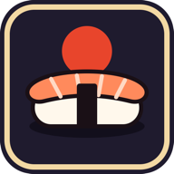

<p align="center">
  
</p>

# Sushi Rush

Jogo de restaurante com visão de cima, feito para navegador e celular. Você é o garçom do seu sushi bar: anota pedido, prepara na cozinha, entrega, cobra no caixa. Com o dinheiro, contrata quem faça isso por você e vira gerente.

## Origem

Terceiro jogo da mesma base (`workspace/games`): Shadow Contract, Blade & Bounty e este. A arquitetura é a mesma (um `World` de dados, sistemas em passo fixo, engine three.js que só desenha, UI React por cima) e os adaptadores de modelo (`src/app/engine/characters`, `src/app/engine/scenery/model-kit.ts`) são cópia dos outros dois. A simulação é nova. Ver `docs/engine-reuse.md`.

Modelos: kit "Sushi Restaurant" (personagens, cenário, comida, decoração), empacotado por `scripts/pack-sushi.mjs` em `public/models/sushi`.

## O jogo

- **Atender por proximidade:** não há botão de ação. Chegou perto, faz: mesa com ✋ anota o pedido; ficar na frente da estação prepara; passar pelo balcão pega o prato; perto da mesa entrega; perto do caixa cobra.
- **Falas:** clientes chamam o garçom, pedem, agradecem, reclamam e conversam entre si (no grupo e na fila); quem atende responde. São só desenho (`world.renderer.ts`), com as frases em `shared/i18n.ts`.
- **Paciência:** cada cliente tem uma barra. Quanto mais sobra quando ele paga, maior a gorjeta; atendimentos seguidos sem perder ninguém formam combo. Paciência zerada: vai embora sem pagar e derruba a reputação.
- **Dias:** cada dia é um turno de 2 min e meio com meta de clientes. Bater a meta paga gorjeta extra. O restaurante fica salvo de um dia para o outro.
- **Duas moedas:**
  - **Moedas** (dinheiro dos pratos): mesas, mesas de 4 lugares, caixas, estações, expansão do salão, pratos do cardápio, contratar e treinar equipe, bandeja e tênis.
  - **Gorjeta:** skins (suas e da equipe), decoração com bônus de paciência e gorjeta, boosts durante o dia e pular a espera de obra ou treino.
- **Gerência:** pela tela inicial, entre um dia e outro, ou durante o dia na sala ao lado do caixa: perto da gerente aparece o botão Gerência (tecla F), que pausa o dia e abre a loja. Equipe, cardápio e melhorias valem na hora; mesa, caixa, estação e decoração aparecem no dia seguinte.
- **Equipe:** garçom (anota, busca, entrega), cozinheiro (opera estação) e caixa (cobra). Cada um sobe até o nível 5.
- **Cozinha:** tábua, fogão e vaporeira; 12 pratos, cada um na estação dele.
- **Reputação:** de 1 a 5 estrelas. Mais estrelas trazem mais clientes e liberam pratos, mesas grandes e expansões.
- **Clientes especiais:** apressado (⚡), crítico (📝, vale 4x na reputação), VIP (👑, pede o mais caro) e grupos de 3 ou 4.
- **Eventos:** hora do rush e a entrega do caminhão (busque o caixote na calçada: pratos valem 20% a mais até fechar).
- **Boosts** (gorjeta, teclas 1 a 4): equipe turbo, cozinha turbo, calma (paciência congelada) e chamar rush.

Todo número acima mora em `src/app/modules/*/constants`.

## Persistência

Zustand salva em `localStorage`, na chave `sushi-rush`: o restaurante (com selo contra edição manual, ver `src/app/store/game-store/save.ts`), a qualidade dos gráficos e se o "como jogar" já foi visto. O idioma fica em `sushi-rush-language`.

## Rodar

```bash
pnpm install
pnpm dev        # http://localhost:5173
pnpm test
pnpm typecheck
pnpm lint
pnpm build
```

Refazer os modelos a partir do kit:

```bash
node scripts/pack-sushi.mjs <pasta sushi-restaurant>
```

## Multiplayer

Ainda não há. `src/app/net` e o `sushi-rush-server` (servidor de salas, que só repassa mensagens) vieram junto para quando houver: o `World` já serializa em JSON, que é o que o snapshot de rede precisa.

## O que ficou de fora da primeira versão

- limpar mesa depois do cliente
- montar prato por ingrediente
- lobby e partida em rede
